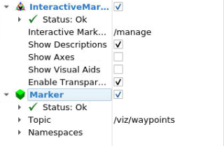
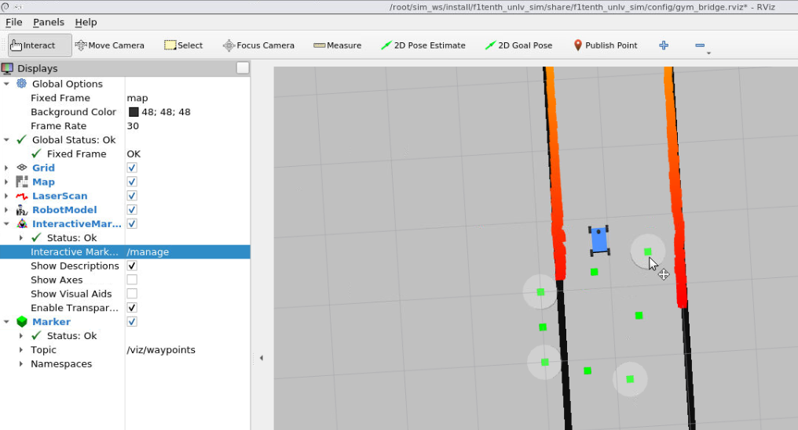
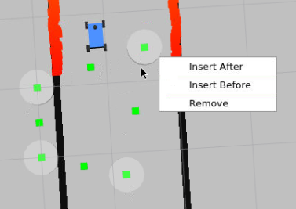

# Lab 6: Managing Waypoints

In this lab, you will become familiar with setting waypoints in the simulator,
and implement interpolating between waypoints.

## Learning Goals

- Learn how to set waypoints in RVIZ 2.
- Learn how to interpolate between two waypoints.

## Lab Setup

We will build off the local file structure given in the first lab. Keep this
structure in mind while you are working through the instructions!

```
${HOME}
  |
  +-- lab1_ws/              -- Lab 1 Workspace folder
  |
  +-- lab2_ws/              -- Lab 2 Workspace folder
  |
  +-- lab3_ws/              -- Lab 3 Workspace folder
  |
  +-- lab4_ws/              -- Lab 4 Workspace folder
  |
  +-- lab5_ws/              -- Lab 5 Workspace folder
  |
  +-- lab6_ws/              -- Lab 6 Workspace folder (NEW)
  |
  +-- sim_ws/               -- Simulator Workspace folder
```

To start with the lab, clone the repository:

```bash
cd ~
git clone https://github.com/unlv-f1/lab6 lab6_ws
```

Then, mount *~/lab6_ws* onto your Docker container, just as you've done for the
previous labs. The repository contains the base code for you to get started.

## Part 1: Specification

Create a package called `waypoints_manager` which:

1. Can read an CSV file of waypoints as input.
2. Can output a CSV file of waypoints as output.
3. Can show waypoints inside of RVIZ.
4. Can modify waypoints inside of RVIZ by moving interactive markers.
5. Can interpolate at least 5 waypoints between any two waypoints. 

**The current base code implementation already implements the first four requirements.** So, if you are working off the base code, you only need to implement the fifth requirement. To do this, you'll need to replace the implementation in `interpolate_waypoints` with your own implementation which can add at least 5 waypoints between any two waypoints.

### Demonstration

If you are using the base code, show that dragging the key waypoints interpolates the rest of the waypoints as specified. If you are not using the base code, please demonstrate that it fulfills all five of the requirements above.

There is no vehicle demonstration for this lab.

## Part 2: Base Code Implementation

This section will cover how to use the base code implementation provided.

### 2-1: Running the Package

First, make sure that the gym is up and running in a different terminal.

Then, build your `lab6_ws` workspace then source it:

```
cd /lab6_ws
colcon build
source install/local_setup.bash
```

Then, run the package:

```
ros2 run waypoints_manager manage --ros-args -p waypoints_file_path:=test.csv
```

This will start a new node called `manage_node`. This node will read any waypoints from `test.csv` (within the current directory) if it exists. If not, it'll write to that file on its next save. Every 10 seconds, the node will write to `test.csv`, saving the waypoints. Your terminal output should be like the one below:

### 2-2: Inspecting the Waypoints CSV File

After 10 seconds, it should have already automatically saved to the CSV file. In a different terminal, do:

```
cd /lab6_ws
cat test.csv
```

This will print the contents of `test.csv` to the terminal. You should see:

```
x,y,is_key
0.0,0.0,True
0.0,0.5,False
0.0,1.0,True
0.5,1.0,False
1.0,1.0,True
1.0,0.5,False
1.0,0.0,True
0.5,0.0,False
```

which are the default waypoints when it's creating a new file. Each row in the file represents a waypoint. For each waypoint:

* The `x` value corresponds to the x-coordinate of each waypoint
* The `y` value corresponds to the y-coordinate of each waypoint
* The `is_key` value is `True` if the waypoint is a **key waypoint**. Otherwise, it is `False` if it's a regular waypoint.

**Key waypoints** are used to interpolate the rest of the waypoints. Inside of RVIZ, you can move key waypoints, and the node will generate the rest of the waypoints through interpolation.

### 2-3: RVIZ

Now, inside of RVIZ, add two new visualizations by clicking "Add" in the bottom-left corner. Add the following visualizations:

* `/manage/update`: An `InteractiveMarkers` topic
* `/viz/waypoints`: A `Marker` topic

Then, for the `InteractiveMarkers` visualization, type in `/manage` for the "Interactive Markers Namespace" value (between "Status" and "Show Descriptions"). This matches the correct namespace for the interactive markers service. Below is the two visualizations as shown in the "Displays" panel:



In the simulator, you should see **8** small green squares and **4** clear circles, as shown below:



The 8 small green squares represent every waypoint, and the 4 clear circles are draggable interactive markers corresponding to each **key waypoint**. You can click and drag the clear circles to move the key waypoints around.

Every time you move a key waypoint, the `manage_node` re-generates the rest of the waypoints through interpolation.

You can also remove and add key waypoints by right-clicking on a key waypoint. Right-click on a clear circle to pop-up a context menu:



There are three options in the context menu:

* **Insert After**: Insert a key waypoint after the one you right-clicked on.
* **Insert Before**: Insert a key waypoint before the one you right-clicked on.
* **Remove**: Remove the key waypoint you right-clicked on. Cannot remove a key waypoint if there less than 4 in total.

## 2-4: Interpolation

To complete the base code, you must replace the current implementation of `interpolate_waypoints` in `manage.py` with your own implementation which can add at least 5 waypoints between each key waypoint. It doesn't need to add at least 5 waypoints for every pair of key waypoints, but it *can* add at least 5 waypoints. (You would have a lot more waypoints in-between if two adjacent key waypoints were placed far from each other.)

The current implementation simply places a single waypoint between each key waypoint, which is the midpoint between those waypoints.

For interpolation, you are free to use a library function, such as from Numpy or Scipy. Note that these packages may not be available in the vehicle environment. Please notify me beforehand if you wish to have certain packages installed on the car.

## Grading Rubric

- **20**: First four requirements.
- **80**: Implemented interpolation as specified.

## Going Beyond

The package you develop for this lab will be the same one you use for the next lab, Pure Pursuit. After completing your requirements, it's up to you how you would like to customize your package. Here are some suggestions:

* **Custom Speeds**: Add a new field to waypoints which represents the desired speed you want the car to be at when it's at that waypoint.
* **Live Waypoints Editing**: With the current implementation, you output a CSV file containing all the waypoints. However, using ROS 2 services/topics, you can choose to update waypoints in *real time*, which can help reduce the downtime with setting new waypoints and file editing.

## Extra Resources

Interactive Markers Documentation ROS: [LINK](http://wiki.ros.org/rviz/Tutorials/Interactive%20Markers%3A%20Getting%20Started)

Interactive Marker Tutorial: [LINK](https://github.com/ros-visualization/visualization_tutorials)

Marker Tutorial: [LINK](https://docs.ros.org/en/humble/Tutorials/Intermediate/RViz/Marker-Display-types/Marker-Display-types.html)

* (This for Humble but should still be applicable)
